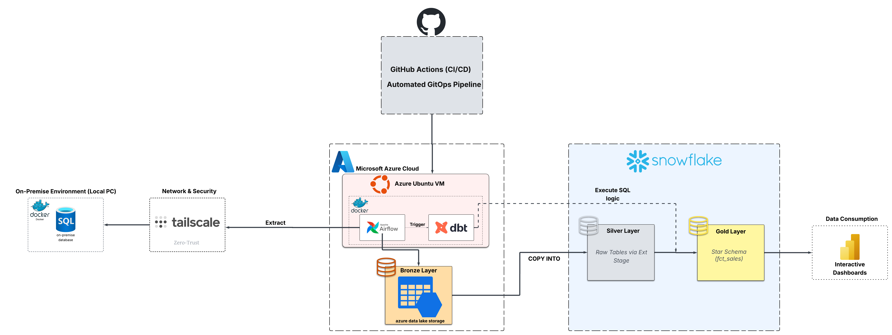
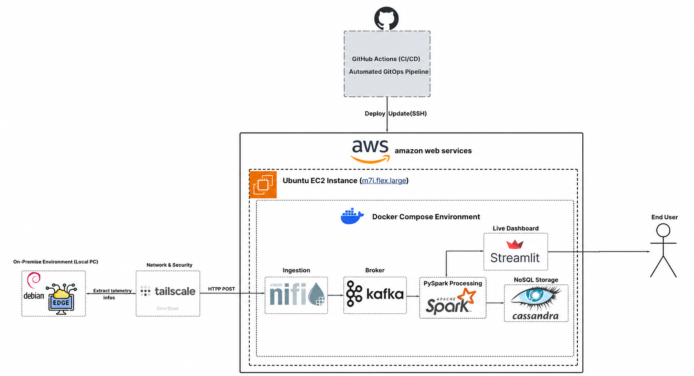
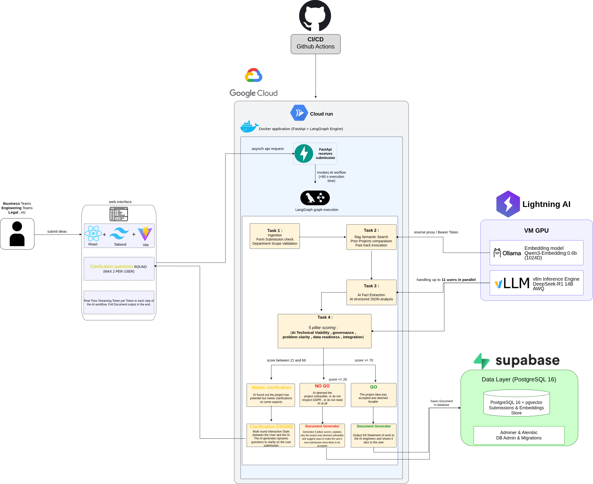
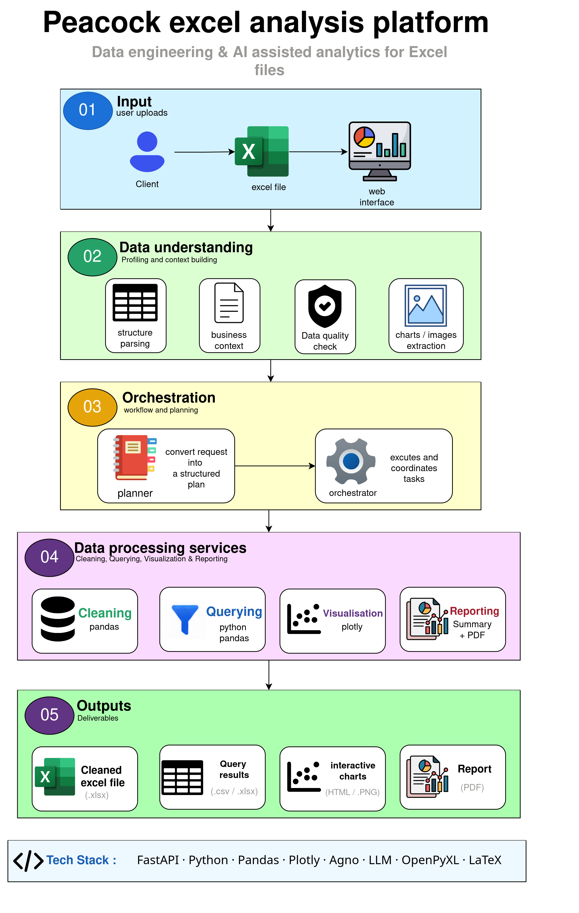

  

 

## 👨‍💻 About Me

### **Data Engineer | Batch & Streaming Pipelines | Cloud Data Platforms**

I am a final-year Big Data & AI Engineering student based in Casablanca, Morocco, focused on data engineering. I build batch and streaming pipelines, cloud data warehouses, and data quality workflows using Python, SQL, Airflow, dbt, Kafka, and Snowflake. My professional experience also includes AI applications for enterprise automation.

---

## 🏆 Data Engineering Projects

### 1. Enterprise Hybrid Cloud ELT Platform
**Tech:** Azure Blob Storage, Snowflake, Apache Airflow, dbt, Docker, Tailscale.
* Built an ELT pipeline migrating on premise SQL Server data into Snowflake on Azure.
* Set up a Tailscale VPN to pull data securely without opening firewall ports.
* Scheduled jobs using Apache Airflow on Azure Spot Instances for cost optimization.
* Modeled data into a Medallion Architecture star schema using dbt Core.

---

### 2. Real Time Edge to Cloud IoT Pipeline
**Tech:** AWS (EC2), Apache NiFi, Apache Kafka, Apache Cassandra, Streamlit.
* Engineered a pipeline streaming hardware telemetry from a local Debian node to AWS EC2 over a secure VPN.
* Utilized Apache NiFi for JSON schema validation and routing into an Apache Kafka cluster.
* Wrote a Python consumer to store data in Cassandra and visualize it live via Streamlit.

---

### 3. Enterprise Data Observability & Fraud Detection Platform
**Tech:** PostgreSQL, Google BigQuery, Apache Airflow, dbt Core, Great Expectations, MLflow, OpenLineage, Apache Superset.
* Automated an end to end Medallion pipeline from local Postgres to daily partitioned tables in BigQuery.
* Enforced data quality guardrails using Great Expectations (GX Core) and dbt tests to prevent DWH pollution.
* Fused an unsupervised Ensemble ML model (Autoencoder + Isolation Forest) via MLflow to isolate behavior fraud.
* Implemented full graph data lineage tracking and real time schema evolution monitoring using OpenLineage and Marquez.
* Generated isolated business pure and quarantine Gold products mapped onto separate Apache Superset dashboards.

---

## 💼 Professional Experience

### 1. [Segula AI Requirement Hub — Sovereign Enterprise AI Scoping Platform](https://github.com/Aboubakr-Tahir/Segula-AI-Requirement-Hub)
**Tech:** PostgreSQL 17 (pgvector), FastAPI, Google Cloud Run, Docker, LangGraph, DeepSeek-R1 (14B AWQ via vLLM), Ollama, React 19 (Vite).

* **Cloud Infrastructure & Database Migrations:** Automated container builds, database migrations, and CI/CD pipelines to deploy frontend and backend services to Google Cloud Run.
* **Semantic Retrieval & Model Serving:** Combined Qwen3 embeddings and PostgreSQL pgvector search with private DeepSeek-R1 models hosted via vLLM on dedicated GPUs, streaming responses through a secure proxy gateway.
* **Enterprise AI Workflow:** Built a conversational system using LangGraph and domain agents to scope requirements, assess feasibility, and generate Statements of Work (SOW) in real time.

#### 🎥 Video Demonstration:

https://github.com/user-attachments/assets/7ef2b1dc-d543-42af-a7cd-0791be6ed310

#### 🏛️ High Level System Architecture:

---

### 2. Peacock — Excel Data Quality & Reporting Automation

**Tech:** FastAPI, Python, Pandas, Plotly, Agno, GPT-4o, OpenPyXL, LaTeX.

* Developed an autonomous agentic platform automating enterprise Excel data cleaning and statistical EDA.
* Automated multi sheet data cleaning, cutting manual spreadsheet preparation time by 85%.
* Engineered an automated imputation and anomaly resolution pipeline across 50+ monthly sheets.
* Automated executive report publishing by compiling LaTeX documents with embedded Plotly charts in under 30s.

#### 🏛️ High Level System Architecture:

---

## 🛠️ Technical Skills

| Area | Technologies |
| --- | --- |
| Languages & Querying | Python, SQL, Scala, Bash, Java |
| Pipelines & Orchestration | Apache Airflow, dbt, Apache NiFi, Pandas |
| Warehousing & Data Modeling | Snowflake, BigQuery, PostgreSQL, Medallion Architecture, Star Schemas |
| Data Quality & Lineage | Great Expectations, dbt tests, OpenLineage, Marquez |
| Streaming & Big Data | Apache Kafka, Apache Spark, Cassandra, Hadoop |
| Cloud & Infrastructure | Azure, AWS, GCP, Docker, Linux, Tailscale |

**Additional AI Experience:** LangGraph, FastAPI, Agno, pgvector, vLLM, Ollama, MLflow.

---

## 💻 The Home Lab
I believe in understanding systems from the bare metal up. To test my data pipelines and deployments locally, I converted an older laptop into a dedicated **Debian Linux home server**. This environment serves as my staging ground for Dockerized orchestration and VPN secured data routing.

### 🎥 Home Lab Live Demo

https://github.com/user-attachments/assets/0ae76f8d-e8aa-41d4-a5d6-70140f6555a1

---

## 🚀 Currently Building & Learning

* Advanced data warehousing, Medallion Architecture, and dbt semantic layers.
* Pipeline orchestration, data quality, and lineage across batch and streaming workloads.
* Infrastructure as Code with Terraform and data engineering deployments on Kubernetes.

---

## 📫 Let's Connect

Interested in data engineering opportunities focused on reliable pipelines, cloud data platforms, and data quality. Let's connect:

* **GitHub:** [github.com/Aboubakr-Tahir](https://github.com/Aboubakr-Tahir)
* **LinkedIn:** [linkedin.com/in/aboubakr-tahir](https://www.linkedin.com/in/aboubakr-tahir)
* **Email:** [aboubakrtahir44@gmail.com](mailto:aboubakrtahir44@gmail.com)
* **Resume:** [Click here to view my updated CV](./assets/Tahir_Aboubakr_CV.pdf)
